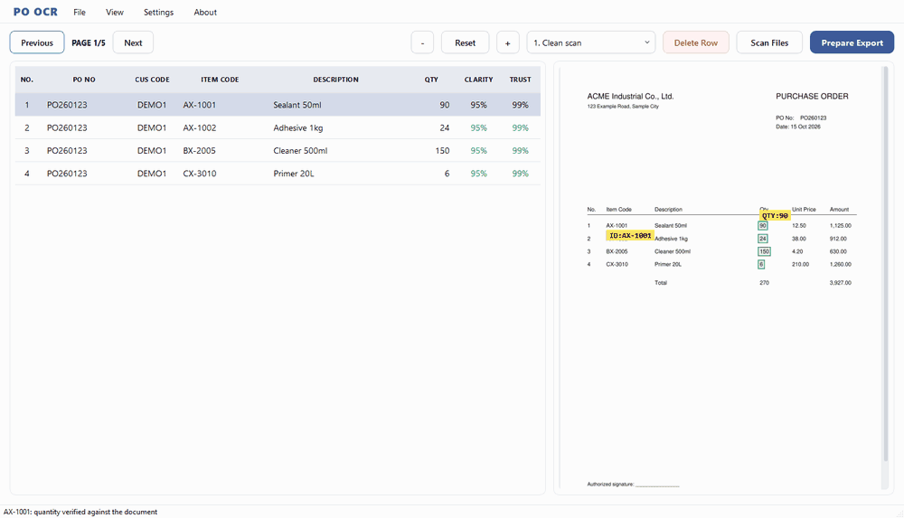
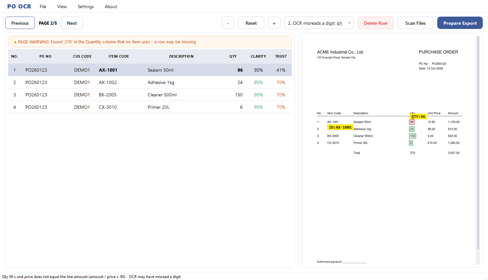
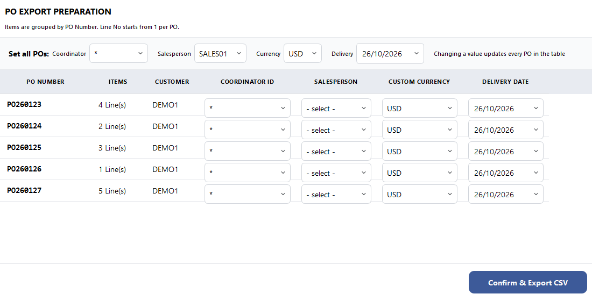

<div align="center">

# Fail-Loud OCR for Purchase Orders

**Safety layer from a production PO-to-ERP automation tool, built on one rule: _a wrong value must never pass silently._**

Python · PaddleOCR · PyQt6 · Flask · PyInstaller

</div>

---

## The problem

Sales coordinators were typing purchase orders into an ERP by hand: PO number, item code, quantity, for dozens of customers, each with a different layout, language and scan quality. Most documents arrive as **scanned copies** (skewed, blurry, stamped), so plain OCR is not enough.

I built an internal desktop tool that reads a PO PDF, picks the right customer format, extracts the fields from zones a person marked once on a sample, lets an operator verify each row, and exports a CSV the ERP can import. It is in daily production use.

> The full application is private (it contains customer layouts and internal systems). This repository publishes the **parts that show the engineering**: the independent verification layer and the design notes behind it.

## Design principle: wrong is acceptable, silent is not

OCR will never be 100% right. A wrong quantity that looks green is far worse than a red cell that asks for a human. Every stage either produces the right value or raises a visible warning.

| Idea | How |
|---|---|
| Read only from marked zones | Find an anchor, measure shift / scale / rotation, map the marked zone onto this page, read inside it. No whole-page regex guessing. |
| Independent quantity cross-check | [`src/qty_guard.py`](src/qty_guard.py) re-reads each quantity a second way and **flags** disagreement. It never edits a value. |
| Second opinion from the PDF text layer | [`src/text_layer.py`](src/text_layer.py) compares OCR output with embedded text when the PDF has it. |
| Silent-drop guards | Total-line and row-number checks catch rows that disappeared. |
| Fail loud | An unreadable zone becomes `Unknown` / red, never a value borrowed from elsewhere. |
| Human in the loop | Review screen shows confidence, warnings and the source crop; export asks again while warnings remain. |

## Pipeline

```
PDF -> page images -> OCR -> route template -> calibrate zones
    -> per-customer engine -> qty_guard (flags only)
    -> verification UI -> ERP CSV
```

One independent engine per customer format, so fixing one customer cannot break another.

## Try it (about 10 seconds, no OCR install)

```bash
pip install -r requirements.txt
python demo/app_qt.py          # desktop review screen (PyQt6), same layout and styling as the real tool
python demo/demo.py            # same scenarios as plain terminal output
python demo/gui.py             # lightweight browser version: http://127.0.0.1:8765
python demo/make_gif.py        # re-record docs/demo.gif (needs Pillow)
```



The screen is the production tool's review step (table on the left, source page with highlighted fields on the right) filled with **fictional test data**. Use the dropdown to inject an OCR failure; extraction reads **only from the marked zones**, and [`qty_guard`](src/qty_guard.py) judges every row. Hover a flagged row for the reason, or select it and read the status bar.

| Misread digit flagged | Prepare Export |
|---|---|
|  |  |

Scenarios: a clean page, a misread digit (90 to 96), an entire row lost, a quantity inflated 100x, and an engine reading the wrong column. Each one ends in a flag or page warning; none passes as green. The OCR stand-in is the PDF's embedded text, so the demo is deterministic; the real tool runs PaddleOCR on scans. Guard messages are Thai in the tool; the demo shows English translations.

## How it was tested

- ~150 real PO files replayed from cached OCR output through every stage (fast and deterministic).
- Before/after **snapshot diffs**: a change may alter only the values it intended to.
- **Fuzzing** of OCR labels (jitter, split/merged words, dropped punctuation, dropped rows), measuring *silent failures*, which must be zero.
- **Rotation stress tests** (+/-1 to 10 degrees) before deskew is enabled for a format.

## What is in this repo

| Path | What |
|---|---|
| [`src/qty_guard.py`](src/qty_guard.py) | Quantity parsing, OCR digit repair, independent cross-check, total-line and row-number guards. Flags only. |
| [`src/text_layer.py`](src/text_layer.py) | PDF text-layer comparison. |
| [`demo/`](demo) | Runnable demos: desktop review screen (`app_qt.py`), browser (`gui.py`), terminal (`demo.py`), fictional PO generator. |

Per-template switches (`TOTAL_CHECK_TEMPLATES`, `PO_FORMATS`, ...) are empty here; in the private tool they are opt-in per customer format after verification on real files.

## Skills shown

Document understanding on noisy real-world scans · fail-safe design and making uncertainty visible · regression discipline (snapshots, fuzzing, stress tests) · PyQt6 desktop UI / Flask tooling · Windows packaging and update flow.

## Author

Nattawat · [@mroatder](https://github.com/mroatder)
